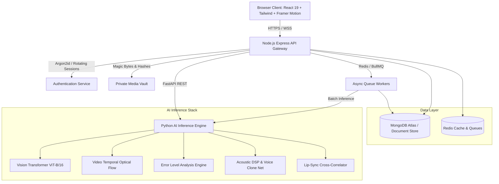

# VERIFAI — AI-Powered Deepfake Detection & Media Verification Vault

VERIFAI is a defense-grade full-stack platform engineered to detect multimodal synthetic media (images, video, and audio), extract and validate cryptographic provenance (C2PA Content Credentials), and preserve digital evidence under ISO/IEC 27037 chain-of-custody standards.

---

## 1. System Architecture



---

## 2. Technology Stack

- **Frontend**: React 19, Vite, TypeScript, Tailwind CSS, Framer Motion, Recharts, React Router DOM, TanStack Query.
- **Backend**: Node.js, Express, TypeScript, MongoDB Atlas, Mongoose, Redis, BullMQ, PDFKit.
- **AI Inference Engine**: Python 3.12, FastAPI, PyTorch, Torchvision, Transformers, OpenCV, Soundfile, SciPy, NumPy.
- **Authentication**: Argon2id password hashing, rotating refresh tokens, HTTP-only secure cookies, and dual email + SMS ownership verification.
- **Email Gateway**: Verified SMTP (Nodemailer) with cryptographically secure 6-digit HMAC-SHA256 OTP.
- **SMS Gateway**: Twilio Verify v2 with international E.164 phone formatting and delivery verification.
- **Storage**: Private vault storage with expiring signed URLs and SHA-256 integrity checks.
- **Evidence Preservation**: ISO/IEC 27037 compliant SHA-256 tamper-evident hash chaining.

---

## 3. The 15 Integrated Features

| # | Feature | Modality | Technical Implementation |
|---|---|---|---|
| **01** | **Multimodal Deepfake Detection** | Image, Video, Audio | Vision Transformer (ViT-B/16) + ELA + 2D FFT spectral residual classification with calibrated probabilities. |
| **02** | **Frame-by-Frame Video Forensics** | Video | Adaptive keyframe sampling tracking temporal flicker, motion inconsistencies, and suspicious sequence timelines. |
| **03** | **Face Manipulation Localization** | Image / Video | Multiscale facial detection with 2D localized manipulation probability heatmaps. Truthful no-face fallback. |
| **04** | **AI-Generated Voice Detection** | Audio | Mel-spectrogram acoustic analysis measuring F0 pitch jitter, shimmer, spectral centroid variance, and vocoder phase diffusion. |
| **05** | **Audio-Video Lip-Sync Consistency** | Video + Audio | Measures cross-correlation between vertical mouth aperture and speech RMS acoustic energy over temporal lag window. |
| **06** | **C2PA Content Credentials** | All | Extracts JUMBF metadata boxes and validates digital certificates to distinguish verified origin from missing credentials. |
| **07** | **Digital Tampering & Edit History** | Image | Error Level Analysis (ELA) and PRNU block-level sensor noise variance homogeneity. |
| **08** | **Cross-Modal Consistency Intelligence** | All | Multi-sensor evidence fusion; flags conflicts between hardware signatures and neural scores without fabricating false certitude. |
| **09** | **Media Fingerprint & Duplicate Search** | All | SHA-256 cryptographic hashes combined with 64-bit dHash perceptual hashing (Hamming distance comparison). |
| **10** | **Live Camera Authenticity Check** | Video + Audio | User-initiated webcam capture with explicit consent, measuring replay and playback anomalies. |
| **11** | **Source & Claim Verification Workspace** | Text / Transcripts | Cross-references extracted assertions with Google Fact Check Tools API and open journalistic fact indexes. |
| **12** | **Explainable AI Forensics Panel** | All | Displays model architectures, checkpoints, 95% confidence intervals, and documented limitations. |
| **13** | **Batch Media Investigation** | All | High-throughput asynchronous media queue managed by Redis and BullMQ with progress tracking and failure isolation. |
| **14** | **Chain of Custody & Forensic Reports** | All | Audit-grade downloadable PDF reports sealed with a tamper-evident SHA-256 hash chain adhering to ISO/IEC 27037. |
| **15** | **Human Review & Collaboration** | All | Analyst workspace with frame-level annotations, second-opinion requests, model disagreement logs, and report sign-offs. |

---

## 4. Real Authentication & Dual Verification

- **Dual Ownership Barrier**: Account activation strictly requires verifying ownership of **BOTH** the user's email address and mobile phone number via independent one-time codes before granting access.
- **Email Verification**: Cryptographically secure 6-digit OTP, stored only as an HMAC-SHA256 keyed hash (`crypto.createHmac('sha256', secret)`). 5-minute expiration, 60-second cooldown, max 5 incorrect attempts.
- **Mobile Phone Verification**: International E.164 format validation (`+[country code][number]`) delivered and verified through Twilio Verify.
- **Zero Production Bypass**: No hardcoded codes, universal OTPs, or mock success fallbacks. Truthful errors are surfaced if external credentials are absent.
- **Password Security**: Memory-hard Argon2id password hashing with salt and strict entropy requirements.

---

## 5. Three Role-Based Portals

1. **User Portal (`/portal/user`)**:
   - `Overview`: Key investigation metrics, recent analyses, quick upload.
   - `New Analysis`: Multi-modal file dropzone with magic byte validation.
   - `Results`: Calibrated manipulation probability gauge, ELA viewer, face localization overlays, and C2PA summary.
   - `Live Capture`: Webcam/microphone recording with explicit consent.
   - `Compare Evidence`: Side-by-side comparison with perceptual dHash Hamming distance.
   - `Claim Verification`: Search public fact check databases for media assertions.
   - `History` & `Reports`: Evidence search, PDF download, and custody chain verification.
   - `Settings`: Verified identity profile, privacy controls, and account deletion.

2. **Professional Analyst Portal (`/portal/analyst`)**:
   - `Investigation Queue`: Case dossiers with priority tags (low, medium, high, urgent).
   - `Case Detail`: Full evidence timeline, linked analyses, and collaborative notes.
   - `Annotations Tool`: Frame annotations with support for recording model disagreements.
   - `Report Approvals`: Review pending reports, sign off or dispute with official comments.

3. **Admin Portal (`/portal/admin`)**:
   - `Dashboard`: Global metrics, risk distribution, storage consumption.
   - `User Directory & RBAC`: Server-side authorization to elevate analyst or admin roles.
   - `Provider Health`: Real-time connectivity diagnostics for MongoDB, Redis, AI service, SMTP, and Twilio.
   - `Model Registry`: Catalog of licensed deepfake detectors and benchmarked FPR/FNR.
   - `Tamper Audit Logs`: Merkle hash-chained ledger with continuous chain integrity validation.

---

## 6. Monorepo Directory Structure

```text
├── frontend/                # React 19 + Vite + TypeScript + Tailwind CSS UI
│   ├── src/
│   │   ├── components/      # Navbar, PortalLayout, UI primitives
│   │   ├── context/         # AuthContext with dual verification
│   │   ├── pages/           # Public, User, Analyst, Admin portals
│   │   └── services/        # Type-safe API client
│   └── vite.config.ts
├── backend/                 # Node.js + Express + TypeScript Gateway
│   ├── src/
│   │   ├── config/          # Zod env schema, MongoDB, Redis
│   │   ├── controllers/     # Auth, Media, Analysis, Case, Report, Claim, Admin
│   │   ├── middleware/      # Auth (JWT/cookies), RBAC, Rate limiter, Error handler
│   │   ├── models/          # 19 strict Mongoose collections
│   │   └── services/        # Argon2id, Email OTP, Twilio SMS, C2PA, PDFKit
│   └── tsconfig.json
├── ai-service/              # Python FastAPI Deepfake Inference Engine
│   ├── app/
│   │   ├── adapters/        # Vision Transformer, Video Temporal, Voice, Face, Tampering
│   │   ├── forensics/       # ELA, 2D FFT Spectral, PRNU Noise, Lip-Sync SyncNet
│   │   ├── models/          # Model registry and metadata
│   │   └── routers/         # Health, Models, Detection endpoints
│   └── requirements.txt
├── workers/                 # BullMQ & Redis async queue worker
│   └── src/index.ts
├── infrastructure/          # Dockerfiles, Nginx configs
├── tests/                   # Vitest, Supertest, and Pytest suites
│   ├── backend/             # Gateway and security tests
│   ├── ai-service/          # Pytest inference tests
│   └── frontend/            # UI and auth policy tests
└── docs/                    # Architecture, API spec, Model registry, Deployment guide
```

---

## 7. Reproducible Startup Commands

### Option A: Complete Docker Compose Stack
```bash
docker-compose up --build -d
```

### Option B: Local Development
1. **Start Python AI Inference Service**:
   ```bash
   python -m uvicorn app.main:app --app-dir ai-service --host 0.0.0.0 --port 8000 --reload
   ```
2. **Start Node.js Backend Gateway**:
   ```bash
   npm run dev:backend
   ```
3. **Start React Frontend**:
   ```bash
   npm run dev:frontend
   ```

---

## 8. Test Execution & Verification

Run the automated test suites to verify that all systems are operational:

```bash
# 1. Run Backend Security & Gateway Tests (Vitest + Supertest + In-Memory Mongo)
npm run test:backend

# 2. Run Frontend Security & Policy Tests (Vitest)
npm run test:frontend

# 3. Run Python AI Inference Tests (Pytest)
$env:PYTHONPATH="ai-service"; python -m pytest tests/ai-service/test_ai_service.py -v
```
