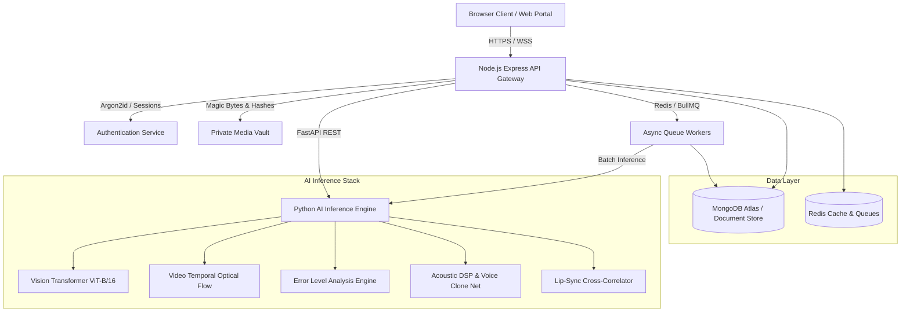

# VERIFAI System Architecture & Technical Specification

## Overview

VERIFAI is a defense-grade full-stack platform engineered to detect multimodal synthetic media (images, video, and audio), extract and validate cryptographic provenance (C2PA Content Credentials), and preserve digital evidence under ISO/IEC 27037 chain-of-custody standards.

---

## Component Topology

### 1. Frontend Layer (`frontend/`)
- **Framework**: React 19, Vite, TypeScript
- **State & Data Fetching**: TanStack Query, React Context
- **Routing**: React Router DOM (v7/v6)
- **Styling**: Tailwind CSS + Custom Dark Cybersecurity Design System
- **Visualizations**: Recharts (Timeline & calibration charts)
- **Portals**:
  - **User Portal**: Single & batch analysis, live capture, evidence comparison, claim fact-checking, history, and PDF reports.
  - **Analyst Portal**: Investigation triage queue, timeline inspector, frame-level annotation, peer collaboration, and report approvals.
  - **Admin Portal**: User directory & RBAC role elevation, model registry health, provider diagnostics, and tamper-evident audit logs.

### 2. Backend Gateway Layer (`backend/`)
- **Runtime**: Node.js 20+, Express, TypeScript
- **Authentication**: Argon2id password hashing, rotating refresh tokens, HTTP-only secure cookies, and dual email + SMS ownership verification.
- **Database**: MongoDB Atlas with 19 strict Mongoose collections.
- **Queues**: Redis & BullMQ for high-throughput batch media processing.
- **Forensic Engines**:
  - `c2pa.service.ts`: JUMBF metadata and digital signature validator.
  - `media.service.ts`: Binary magic byte inspection, SHA-256 and perceptual 64-bit dHash calculator.
  - `pdfReport.service.ts`: Multi-page audit-grade PDF generation with PDFKit.
  - `audit.service.ts`: Cryptographic tamper-evident hash chaining.

### 3. AI Inference Service (`ai-service/`)
- **Framework**: Python 3.12, FastAPI, Uvicorn
- **Frameworks & Libraries**: PyTorch, Torchvision, Transformers, OpenCV, Soundfile, SciPy, NumPy
- **Inference Adapters**:
  - `image_detector.py`: Vision Transformer + ELA + 2D FFT spectral residual classification.
  - `video_detector.py`: Adaptive keyframe sampling and inter-frame temporal divergence tracking.
  - `face_localizer.py`: Multiscale facial detection with 2D manipulation probability heatmaps.
  - `voice_detector.py`: Mel-spectrogram analysis tracking F0 pitch jitter, shimmer, and spectral flatness.
  - `lipsync_detector.py`: Cross-correlation between mouth aperture ratio and speech energy envelopes.
  - `tampering_analyzer.py`: PRNU sensor noise variance consistency and double JPEG quantization grids.

---

## Cryptographic Chain of Custody (ISO/IEC 27037)

All investigative actions, model runs, analyst notes, and verdicts are recorded in a tamper-evident hash-chained audit log:

$$\text{CurrentHash}_i = \text{SHA-256}(\text{PreviousHash}_{i-1} \parallel \text{Timestamp} \parallel \text{ActorId} \parallel \text{Role} \parallel \text{Action} \parallel \text{Resource} \parallel \text{TargetId} \parallel \text{JSON}(\text{Details}))$$

Any retro-active alteration of previous events causes immediate chain invalidation detected by `AuditService.verifyChainIntegrity()`.
